# Implementation and Delivery Plan

Updated on 2026-11-12. The engineering configuration and discovery checks are complete. The scoped independent final re-review passed at source commit `87df280e33c204e5dd85151a45b570b8adcfbaae`, with 68 tests passing and package SHA-256 `3395dea80c52d312259215096136f253115d10dc500876c778dcb3789f5f9088`. See the [review](review-v0.1-2026-11-12.md) and [validation record](validation-v0.1-review-fixes-2026-11-12.md) for results and limitations.

## Delivery Goal

One target and symptom should produce a bounded collection round, explicit counterevidence, a scoped status, at most two supported directions, and a concrete next step. The sequence is input, bounded collection, normalized observations, provenance validation, counterevidence, diagnosis, report, and reproducible artifacts.

| Milestone | Deliverable | Acceptance condition |
| --- | --- | --- |
| M0: discovery | Engineering configuration, source hashes, legacy checks, implementation tasks | Evidence and limitations are traceable |
| M1: executable v0.1 | 25-second collection, four diagnosis states, report, optional offline PCAP | Real CLI execution; bounded failures; references can be checked |
| M2: submission candidate | Twelve-case replay, controlled experiments, native Windows/Linux validation, MobileWork checks | Required assertions pass against the frozen package; missing validation is disclosed |
| M3: extensions | One path adapter, Globalping, then HAR/WebRTC and all 30 cases | Actual tool-output samples, budgets, disclosure scope, and failure handling for each extension |

The current user-directed goal is M1 plus meaningful automated checks, twelve diagnosis replay cases, independent review, and release packaging. M2 validation cannot be claimed from deterministic replay alone.

## v0.1 Collection Scope

### Live collection

- Complaint URL and an optional configured control URL. An absent or uncalibrated control reduces available comparison evidence; do not choose an arbitrary public site and label it healthy.
- HTTP: up to three attempts per target, six requests total, concurrency two; three-second connection timeout, six-second request timeout, no automatic retry or redirect; read-only GET with validated certificates.
- DNS: optional structured dnslookup adapter, explicit A/AAAA queries, resolver/transport recorded, at most four queries. OS implicit DNS lookups are distinct.
- Latency: default gateway, actual complaint address, actual control address; at most ten samples per endpoint at 1 Hz, thirty logical Echo requests total. Record actual sent/received counts and missing samples.
- Read-only context: platform, relevant tool capabilities, default route/interface when readable, proxy presence, address family, and available interface counters. Exclude proxy credentials.
- Shared 25-second deadline includes discovery, context reads, subprocess termination, and two seconds reserved for completion. Partial results remain usable with explicit reasons.

The HTTP body-read budget is 64 KiB. Enforce the limit using the adapter and validated tool behavior; Range alone is insufficient. Distinguish stored bytes from tool-reported transport bytes and wire traffic. A truncated body does not measure a complete download.

### Offline PCAP

Offline mode is independent of live probing. Initial limits: regular input file up to 64 MiB, 100,000 input frames, 8 MiB event output, 64 KiB retained stderr, and 25 seconds including discovery/hashing. Preserve frame numbers, capture scope, filter, parser version, capture timestamps, and hashes.

Support visible DNS/TCP/TLS metadata and HTTP/1.x evidence where decoding permits it. Encrypted traffic remains bounded by actual visibility. See [TShark integration](research/tshark-integration.md).

Live capture, driver installation, privilege changes, active throughput tests, key acquisition, path collection, and external measurement are later extensions. Path-report replay can test reasoning without claiming an implemented path collector.

## Module Boundaries

```mermaid
flowchart LR
    I[Target and symptom / existing PCAP] --> R[Capabilities and shared budget]
    R --> A[Tool adapters]
    A --> E[Evidence and provenance validation]
    E --> D[Counterevidence and scoped diagnosis]
    D --> O[JSON and Markdown report]
    C[Isolated evaluation controller] -->|ticket and allowed evidence only| I
    O --> V[Independent evaluation]
```

Keep the distributable under `skills/internet-access-triage/`. Development tests, controller truth, build scripts, research, runtime outputs, and release artifacts stay outside it. Build the ZIP from an explicit allowed-file list.

The runner owns deadlines, process termination/reaping, bounded output, and command records. Adapters own tool-specific parsing and observations. Diagnosis owns evidence-supported conclusions. Rendering consumes the same diagnosis object. An adapter does not choose root causes or silently activate another service.

| Evidence concern | Required meaning |
| --- | --- |
| Identity | Run/evidence ID, tool source/version, adapter version |
| Target | Redacted URL, hostname, actual IP/family, transport/application protocol, resolver, proxy context, method |
| Time | Collection start/end and monotonic duration; separate capture and analysis windows |
| Execution | Exit code, completion/partial/timeout/permission/unsupported/unexecuted/budget/parser/cancellation/tool-error outcomes |
| Measurements | Original values/units, normalized units, direction, denominator, sample count, null plus missing reason |
| Observations | Structured answers, response codes, error facts, addresses, repeated fields |
| Provenance | Artifact path/hash and record or packet references; explicit absence when no artifact exists |
| Coverage | Truncation, visibility gaps, unavailable capabilities, comparison prerequisites, actual costs |

Expected outputs are manifest.json, evidence.jsonl, diagnosis.json, report.md, and controlled local raw artifacts. Errors still produce an execution summary. Shared exports and local original evidence need distinct hashes and a recorded redaction relationship.

## Diagnosis Rules

Before selecting a direction, establish whether the symptom was reproduced, which targets/protocols/windows are affected, what contradicts the proposed cause, and the most specific supported layer.

| State | Meaning |
| --- | --- |
| fault_observed | Business failure or a validly supported anomaly was observed within the stated scope |
| healthy_within_scope | Sufficient business coverage and valid baseline support health in that scope |
| not_reproduced | A historical/intermittent complaint did not recur in the limited observed window |
| insufficient_evidence | Missing capability, coverage, or comparability prevents the requested conclusion |

Allow zero to two candidate domains, each with supporting evidence IDs, counterevidence, limits, and next actions. Successful parsing or ping alone does not establish health. Tool failure is not itself a business failure. The user's proposed cause cannot replace observations.

Derive curl phase differences only when actual connection/proxy/protocol semantics permit them. Preserve raw cumulative timings otherwise. A same-IP DNS comparison requires matched URL, Host, SNI, certificate verification, address family, actual IP, method, proxy path, and time window. Different CDN answers do not isolate resolver processing time. [curl manual](https://curl.se/docs/manpage.html).

## Implementation Tasks

These are task definitions, not published GitHub issues or automatic triage decisions.

| Task | Dependencies | Observable completion |
| --- | --- | --- |
| T01: evidence and diagnosis contract | None | Typed nested values, units, missingness, artifact paths/hashes, valid evidence references, four states, two-direction limit; invalid inputs rejected |
| T02: bounded runner and capability discovery | T01 | Shared deadline, output cap, process cleanup, truthful missing-tool/permission outcomes; hanging/noisy child tests |
| T03: curl and read-only context | T02 | Real local service checks for phases, timeout, certificate failure, redirects, body cap; actual addresses/proxy/family recorded |
| T04: DNS and finite ping | T02 | Explicit record/resolver/transport, native platform output samples, elapsed units, response sequence, missing-tool degradation |
| T05: offline TShark | T01/T02 | Field discovery, bounded parsing, packet/hash references; empty/damaged/filtered/truncated/missing-field/timeout distinctions |
| T06: diagnosis and report | T03/T04, plus T05 for PCAP | Evidence precedes attribution; same observations resist misleading tickets; short normal windows remain appropriately scoped |
| T07: twelve-case replay | T06 | Independent expected results outside runtime; state, layer, references, and overclaim assertions; actual pass/fail records |
| T08: controlled experiments | T03/T04/T06 | DNS delay, TCP timeout, response delay, upload contention independently confirmed; original-path recovery, configuration cleanup, residual-resource checks |
| T09: packaging and MobileWork validation | T05-T08 for submission | Explicit package file list, version/hash/licenses, native platform runs, actual client import/trigger/workflow/screenshots |
| T10: path and Globalping | After M2 | One bounded path adapter, total round90sec, external time shared; actual probe location/ASN/IP/protocol/time; permission/truncation counterevidence |
| T11: application evidence and thirty cases | T10 or an explicit business need | HAR resources/privacy, same-session media stats, protocol/family/proxy cases, actual platform support matrix |

T01-T07 and the release-building portion of T09 passed the [scoped independent final re-review](review-v0.1-2026-11-12.md), with implementation and local checks recorded in [v0.1 validation](validation-v0.1-review-fixes-2026-11-12.md). Track T08 and actual client/native-Windows checks as outstanding. Native output parsing tests do not count as running that operating system.

## Twelve Core Diagnosis Cases

This set comes from the research archive's minimum_initial_suite. It is unrelated to the legacy CSV sample's twelve synthetic devices.

| Case | Evidence and comparison | Required conclusion boundary |
| --- | --- | --- |
| INET-01 | DNS delay, curl phases, same-IP comparison | DNS stage; no recursive-server CPU claim |
| INET-05 | One-target connection timeout and healthy control | Target connection/path direction; responsibility unresolved |
| INET-06 | TLS validation error and independent check | TLS direction; keep certificate verification |
| INET-07 | Server response wait or controlled transfer restriction | Response wait versus download; proxy handshake delay is not pure TTFB |
| INET-10 | Repeated idle/load/recovery windows and interface/queue evidence | Load-related queuing; correlation alone is not confirmed bufferbloat |
| INET-18 | Missing intermediate-hop responses with normal endpoint/business results | No inferred forwarding loss from intermediate response loss |
| INET-20 | Sufficient independently verified same-window health | healthy_within_scope despite a misleading ticket |
| INET-23 | Short normal window and intermittent historical complaint | not_reproduced; no false-premise assertion |
| INET-24 | Actual PCAP, capture scope, retransmission indicators | Observable facts; insufficient evidence for invisible device/AS attribution; no invented live probes |
| INET-25 | Normal DNS/TCP/TLS with later response wait | Counterevidence to DNS; request/response stage only |
| INET-26 | Path permission error plus observed business failure | Retain business anomaly; reduce localization |
| INET-27 | One target fails while matched control succeeds | Target-specific direction; no Internet-wide conclusion |

Report three separate kinds of validation: adapter behavior, diagnosis replay, and controlled end-to-end experiments. Replay does not establish injection effectiveness or public-network accuracy. An invalid injection/recovery run is an invalid experiment, not a diagnosis success or failure.

Freeze scoring before a formal run: state first, then allowed localization layer, then classification. Record evidence grounding, false positives/overclaims, tool completion, elapsed time, and cost separately. A lucky hidden-cause guess without visible support cannot pass evidence grounding.

## Release and Submission

The runtime ZIP includes only necessary entry instructions, source, configuration/contracts, references, LICENSE, and dependency declarations. Keep controller truth, test inputs, injection code, research originals, actual captures/HAR, keys, and run outputs out of it.

Separate validation material records package version/hash, environment/tool versions, commands/exit codes, test outcomes, controlled-experiment effectiveness and three recovery assertions, actual MobileWork screenshots, and V-01/02/03. Rebuilds must preserve a clear relationship between the reviewed source and tested package.

Before submission, resolve the entry-name, external-GPL, and diagnostic-protocol questions in [the baseline](research/current-state.md#publication-requirements-read-from-the-supplied-documents). Internal checks do not constitute the security agency's 43 static and 17 dynamic checks.

Use `to-spec`/`to-tickets`/`triage` only for their actual engineering purpose and authorized tracker scope. Record domain decisions when settled; investigate demonstrated failures rather than treating every available skill as a required step.
