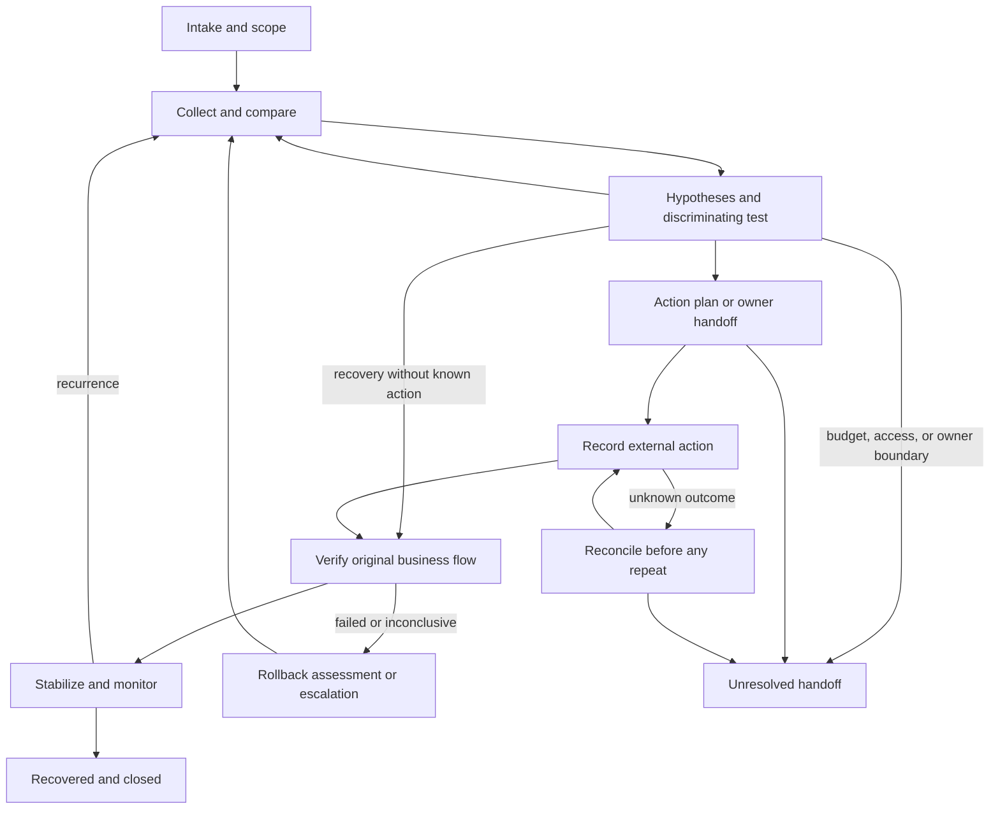

# Proposal: operator-controlled incident lifecycle

**Status:** research proposal, 2026-11-12. No implementation or architecture decision is approved by this document. The [source analysis](closed-loop-tools-and-practices.md) and [ten lifecycle journeys](closed-loop-scenarios.json) are designed, not executed. The [delivery plan](../delivery-plan.md) remains the v0.1 contract and its outstanding validation remains outstanding. The [previous 16 cases](deep-triage-cases.md) are preserved. This proposal grants no authority to send messages, create or update tickets, change services or devices, or run new probes.

## Outcome and boundary

A case follows the affected business flow from intake through evidence, decision, an operator or external owner's recorded action, same-path recovery verification, stabilization and closure. If it cannot complete safely, it stops with a truthful non-success outcome and an actionable handoff; it does not claim every problem can be fixed automatically. Desired business outcome is distinct from a device command or a root-cause theory ([INTENT], [ASSURANCE]). A field team, application owner, network provider or customer may own the actual change. A case may recover without a confirmed cause, or have a strong cause while the service remains broken.

| Area | Existing v0.1 | Proposed gap and first response |
| --- | --- | --- |
| Input/scope | One target and symptom; bounded local context and optional offline PCAP | Durable incident ID, affected service, original vantage/identity, scope, ownership, input provenance, and known/unknown dependencies. |
| Collection | Existing bounded round, shared 25-second deadline, optional structured DNS and offline PCAP | Budget multiple separate rounds and manual imports; map scoped inventory and freshness. New telemetry sources are later optional adapters. |
| Diagnosis | Four scoped states, evidence and counterevidence, at most two directions | Preserve each run's diagnosis unchanged; hypotheses, tests and their evidence accumulate in a separate case record. |
| Action | Report a next step; no live repair | Record proposed and operator-executed action, preconditions, expected impact, verification and rollback; no command execution by first slice. |
| Recovery | A scoped diagnostic result | Verify original affected business flow, monitor an agreed window and SLI, then close only on sufficient evidence. |
| Coordination | Run artifacts | Durable transitions, cancellation/resume, unresolved outcome and handoff drafts; no external writes. |

## Lifecycle and state contract

The proposed controller holds one durable case, independent of the existing `fault_observed`, `healthy_within_scope`, `not_reproduced`, and `insufficient_evidence` diagnosis values. Each run stores its own diagnosis, scope and evidence references. Neither a diagnosis state nor ticket status directly sets the workflow state.

Proposed workflow states are `intake`, `investigating`, `awaiting_action`, `action_outcome_unknown`, `verifying`, `stabilizing`, `closed_recovered`, `closed_unresolved`, and `cancelled`. `closed_unresolved` is an administrative handoff or a reasoned stop, never technical resolution. `cancelled` records who stopped work and any in-flight or unknown action. A case may reopen from either closed state or cancellation on new evidence, recurring symptoms, or an owner request; append a reason and new episode, preserve history and re-establish baseline/authorization. No transition should erase a prior episode. When service recovers without a known action, record that observation and move from investigation to verification without fabricating an action; the same recovery and stabilization gates still apply. A refusal to act, unavailable owner, exhausted budget, unreproducible intermittent problem, inaccessible vantage, unsafe change, unknown action outcome, failed rollback or incomplete verification can all stop as unresolved. If the system cannot record a safe handoff, leave the case open rather than inventing closure.

The following gates make transitions reviewable:

1. **Intake:** assign case and episode IDs; record reporter/time, symptom and business impact, affected service and user population, original client/vantage, identity or representative test account, application operation, target/hostname, family, proxy/VPN, onset/window, severity and source provenance. Mark unknowns. Never store credentials in artifacts.
2. **Scope and baseline:** map service to known components, ownership, intended and observed topology, links, interfaces, routes, resolver and relevant dependencies with source/version/as-of time, confidence and unknown edges. Treat source-of-truth inventory as declared intent, not current truth ([NETBOX], [ASSURANCE]). An agreed SLI, successful baseline and comparable time window are preferred; record absent or uncalibrated baselines instead of inventing health.
3. **Evidence and tests:** before DNS, inspect available read-only local addressing, default route, link and ARP/ND when access is in doubt. Where authorized and relevant, use existing CPE/BNG PPPoE session and AAA evidence to distinguish discovery, session and authentication, with absent logs marked unknown ([PPPOE], [DHCP]). Do not enable debug toggles, broadly scan or reset credentials. Select the cheapest permitted test likely to distinguish up to two competing directions and state its expected supporting and falsifying outcomes. Record observations, missingness, samples, actual scope, source, collection and event timestamps, tool/version and hashes. A test failure is not the business failure. Existing v0.1 can supply a round; other methods remain proposals.
4. **Decision:** link hypothesis, supporting evidence, counterevidence, remaining alternatives and confidence separately from observed impact. On inconclusive or contradictory data, collect another permitted test or stop. Do not convert correlation, stale inventory, alert silence, an intermediate-hop timeout or one healthy ping into causation or resolution ([ALERT]).
5. **Plan and human action:** record the action owner, incident and change references if supplied, evidence IDs and hypothesis, current preconditions and affected scope, intended change/diff, backup or restore point and its availability, risks and dependencies, expected business check, rollback trigger, rollback owner and steps, time limit, approval/authorization reference, and no-change alternative. Refresh preconditions immediately before any action. If a safe plan or owner is unavailable, hand off unresolved. A human or external system executes under its own authority; the first slice only records who did what, when, where, result and evidence, including partial or unknown results. No execution is inferred from approval alone.
6. **Verification:** compare the original affected vantage, same application operation and identity/permissions, destination, proxy/VPN, family and workload to the original scope. Record deliberate differences and their effect. The operator must define an objective business success criterion and data window before action; no arbitrary ping, configuration applied, ticket closure or unrelated synthetic check substitutes. If original vantage is unavailable, use a clearly labeled proxy only to inform investigation; close unresolved until acceptable evidence is available. Failure or incomplete evidence leads to reassessment, operator rollback when its trigger is met, or escalation; record rollback result and verify both service and rollback effects.
7. **Stabilization and closure:** define duration, sample cadence, minimum coverage, relevant SLI threshold or baseline and recurrence condition with the service owner; use no universal invented threshold. Track missed windows and confounders. Close recovered only after the original business check and agreed stability criterion pass with sufficient coverage. Record root-cause certainty separately, residual risk, timeline, unresolved follow-up and ownership. A regression during the window returns to investigation; later recurrence opens a linked episode. Draft a blameless learning record and follow-up when warranted ([SRE]).

## Collection, comparison and budget

A proposed case budget is explicit and finite: total elapsed active collection time, number of rounds, tests, requests, bytes, concurrency, external interactions and each step's deadline/output cap. Reserve capacity for verification and cleanup before spending on diagnosis; a long human wait does not extend a subprocess deadline. Each authorized new round draws a bounded allocation from the persistent case total; retries and resumes consume the remaining total and never reset it. Any increase requires an explicit recorded budget decision. Values must be set per use case and enforcement designed before implementation; retain v0.1's existing 25-second round and limits unchanged. Record planned versus actual cost, partial results, truncation, permission and unsupported outcomes. Optional load generation or third-party measurement needs separately authorized traffic, privacy and cost budgets; neither is in the first slice.

For every telemetry series, map incident service → dependency → device/interface or application → source query/label/path, unit, sample time, ingestion time, freshness limit, collection cadence, coverage and owner. Identify source clock uncertainty, counter reset/wrap, gaps and inconsistent labels. A stale or missing series is unknown, not zero. Compare only when target, vantage, identity, protocol, family, proxy, time, workload, source semantics and calibration are sufficiently equivalent for the question; record differences and mark comparisons ineligible if essential conditions fail. Normal versus pinned HTTPS requires matching host, Host/SNI, certificate validation, method, actual endpoint, family and proxy semantics. Different CDN addresses cannot isolate resolver processing time ([CURL], [ECS]).

## Small case controller seam

The first delivery should expose a small local interface, not a platform: `open_case(input)`, `append_evidence(case_id, expected_revision, evidence_ref)`, `record_decision(case_id, expected_revision, decision)`, `record_action(case_id, expected_revision, action_record)`, `transition(case_id, expected_revision, event)`, `get_case(case_id)` and `export_report(case_id)`. These names express responsibilities, not an approved API. A storage implementation hides durable append-only event history and materialized state behind the seam. Every event has a unique ID, case/episode ID, actor, timestamp, revision, source/provenance and references to immutable or hashed evidence. Validate legal transitions and required gate data atomically; use revision checks to prevent lost concurrent updates. Apply a repeated event ID at most once and reject conflicting payloads. Store only redacted exports and an explicit relationship to restricted originals; define retention, access and integrity policy before real deployment.

A restart reloads committed events and resumes only explicitly requested, safe read operations within the remaining budget. Cancellation stops scheduling new work, attempts to stop and reap local processes, and records any in-flight operation until its actual result is known. If an external action may have executed but its acknowledgment is lost, set `action_outcome_unknown`, preserve its correlation/idempotency key and query the authoritative owner or action record. Never blindly repeat it; reconcile observed state and obtain a new decision first. Event idempotency does not imply remote-action idempotency. The manual first slice avoids dispatching such actions; the rule is required for any future integration ([ORQUESTA]).

## Delivery options and decision

| Option | Lifecycle and tradeoff | Decision |
| --- | --- | --- |
| Human-assisted local case lifecycle | Reuse bounded automated diagnostic collection, choose and record the next discriminating test, propose an action, record human execution, independently verify and stabilize the original business flow, and export a draft handoff. Small deployment and clear authority; an owner must carry out changes and monitoring. | **Recommend first.** It delivers the entire workflow spine and all non-success exits, even when an adapter or owner is unavailable. |
| Configured read-only NMS/device adapters | Add scoped inventory, metrics and snapshots to the same lifecycle. Better coverage where data already exists, at the cost of credentials, identity mapping, freshness, load and platform maintenance. | Later, guided by actual case demand and verified sample output. |
| Explicitly provisioned reversible actuation | A separately authorized execution service might apply narrowly defined changes and reconcile results. It adds material authority, platform-specific rollback, concurrency and unknown-outcome risks. Not every device or action supports reversal. | Last, only after a separate architecture and authorization decision; never a condition for an honest handoff. |

Architectural design approval is the first gate before any implementation. Research and designed scenarios do not constitute that approval.

## Ranked delivery and acceptance

1. **One complete local vertical slice:** approved case schema/controller, bounded v0.1 collection and evidence import, next-test selection and record, one human action proposal and execution record, original-path verification, stabilization record, recovered/unresolved closure, cancel/reopen and a draft handoff report. Use representative local test inputs and a simulated manual action; no actual ticket or device writes. Acceptance must demonstrate recovery *and* failed verification/rollback, unavailable vantage, budget exhaustion, cancellation/restart, duplicate event, concurrent revision conflict and unknown action outcome; assert no false recovered state or retry. Include coverage and evidence references in reports. For offline PCAP acceptance, use substantial actual publicly documented captures and/or traceable perturbations derived from them; record source, provenance, original hash, capture window, exact variant operations, and derived hash. Run the original and derived files, preserving actual limits and results. Short synthetic captures are unit-test inputs only, not persuasive operational evidence. Frame removal or reordering simulates capture impairment and cannot establish real network packet loss or recovery.
2. **One scoped comparison:** add the highest-value permitted DNS versus endpoint comparison from the prior research, preserving comparison eligibility and independent negative controls. Test actual adapter sample outputs and budgets separately from case replay.
3. **One read-only inventory or telemetry adapter:** choose by a real service question; prove identity mapping, stale/missing/reset handling and bounded collection with versioned sample tool output. Use snapshots or offline Batfish preflight only if their added fidelity justifies maintenance ([PROM], [GNMI], [SUZIEQ], [PYATS], [NAPALM], [BATFISH]).
4. **Only after separate architecture and authorization:** external ticket handoff or execution adapters with least privilege, explicit approval, audit, operation identity, reconciliation and target-specific rollback. A draft export is the first-slice handoff; a remote ticket's status never proves technical recovery ([JIRA], [TMF621OAS]).

The controller design, storage and lifecycle terms are proposals for review; no ADR or glossary entry is settled here. A future ADR must resolve ownership, persistence, retention, authentication, safe failure behavior, and coordination with existing report schemas before implementation.

Source IDs link to primary sources in [the research registry](closed-loop-tools-and-practices.md).
