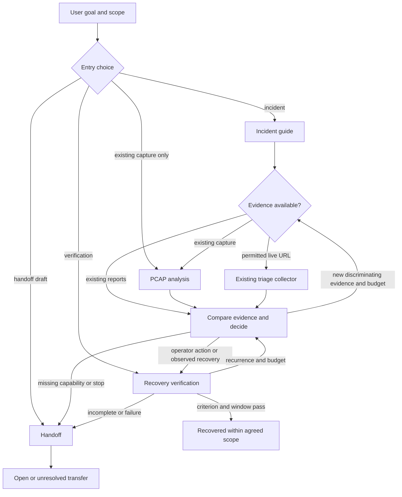

# Proposal: a composable network operations skill suite

**Status: design for user review, 2026-11-12.** No proposed skill, controller, adapter, bundle, retry loop, or recovery automation exists yet. No live probes, external messages, ticket writes, device or configuration changes are authorized by this document. [Source review and current audit](skill-composition-patterns.md) distinguish observed capabilities from proposals. [Routing cases](network-skill-suite-routing-cases.json) are designed, not executed.

## Purpose and alternatives

The requested outcome is a small set of independently useful network workflows that can cooperate on a real incident while retaining direct access to offline capture analysis. The existing collector is the starting point. The suite should expose evidence, missing capability and limits rather than promise automatic repair. This recommendation assumes an operator controls changes and supplies the affected business success criterion; revise it if the intended operating model differs.

| Approach | Benefits | Costs and decision |
| --- | --- | --- |
| One skill with modes and progressive references | Least installation and discovery overhead; shared context stays simple. | Good fallback if forward tests find the proposed separate goals too similar. A broad description may confuse standalone capture, verification and handoff requests; an incident body may accumulate unrelated rules. |
| **Small suite of related, direct-entry skills** | Distinct triggers, inputs and success criteria; offline capture or a handoff can be requested alone. Incident workflow composes evidence only where relevant. | Requires tested discovery, compatibility and release closure. **Recommended design**, subject to independent behavior tests and user approval. |
| Large, always-orchestrated graph with per-protocol skills | Could expose many specialist workflows. | Many empty boundaries, repeated context, brittle routing and implied capability; defer until independent real requests and validated workflows justify each split. No graph is provided by the format. |

## Proposed skills and boundaries

Descriptions below are draft selection signals, not implemented frontmatter. Inputs may be incomplete: mark unknowns, ask only for what is needed, or stop with the available evidence. Each proposed goal is independently invocable; the incident workflow is optional.

| Skill and status | Proposed description, trigger and exclusions | Inputs → output | Dependency and direct entry |
| --- | --- | --- | --- |
| `internet-access-triage` **available v0.1** | Existing description: diagnose a specific internet access symptom from bounded local HTTP, DNS, ping and existing PCAP evidence. Use for a URL or existing capture. | URL or PCAP and scope → run evidence, scoped diagnosis, report and manifest. | Python stdlib; optional external tools. Direct entry today. Offline mode remains supported even if the proposed PCAP skill is absent; never add a live probe to it. |
| `netops-incident` **proposed** | Guide an active network incident through evidence, decision, an operator action record and verification. Use when the user wants coordinated incident investigation or follow-through; exclude a standalone file analysis or a handoff-only request. | Business symptom, vantage, permissions, evidence and finite budget → case decisions, explicit open/closed outcome and optional draft. | Can start alone; use available collector or supplied reports where appropriate. A durable controller is separately proposed, not assumed. |
| `netops-pcap-analysis` **proposed** | Interpret existing packet captures for a scoped network question. Use when a user provides PCAP/PCAPNG and asks about the recorded traffic; exclude live capture and inferential claims beyond visibility. | Capture, question and known vantage/time → evidence-linked findings, alternatives, visibility and limits. | Direct entry. May use existing collector's offline CLI if installed; otherwise state unavailable analysis capabilities and use only actually available permitted tools. Never trigger live collection because this skill is missing. |
| `netops-verify-recovery` **proposed** | Assess whether the original affected business operation recovered and stayed stable over an agreed window. Use after an action or observed spontaneous recovery; exclude routine initial diagnosis. | Original vantage, identity, operation, target, family, workload, criterion, observed checks and stability window → comparable checks, gaps and recovery decision. | Direct entry from supplied checks or case. No automatic production check is implied. Missing required comparison means unresolved, not recovered. |
| `netops-handoff` **proposed** | Draft an incident transfer or learning record from supplied evidence and decisions. Use when an operator requests a handoff or postmortem draft; exclude sending it or claiming a cause. | Case, run reports or notes → draft with evidence, uncertainties, owner and next action. | Direct entry; no external service or other skill required. No send or ticket write by default. |

DNS, TLS, path and device material should be conditional references only when it changes decisions. Promote one to a separate skill only after a distinct real user goal, input/output contract, tested examples and maintainable implementation exist. One file-only analysis need not go through every lifecycle step. Explicit user choice overrides automatic routing within authorized scope; missing data and permissions remain visible.

For review, these are concrete **drafts**, not files or approved trigger behavior:

```yaml
name: netops-incident
description: Guide an active network incident from scoped evidence through an operator action record and recovery checks. Use for coordinated incident investigation or follow-through; use a focused file analysis or handoff workflow when that is the whole request.
```

```yaml
name: netops-pcap-analysis
description: Interpret existing packet captures for a scoped network question. Use for PCAP or PCAPNG evidence; do not start a live capture or infer facts outside the recorded visibility.
```

```yaml
name: netops-verify-recovery
description: Assess recovery and stability of the original affected business operation. Use after an operator action or observed recovery when comparable checks and success criteria are available.
```

```yaml
name: netops-handoff
description: Draft a network incident transfer or learning record from supplied evidence and decisions. Use for a handoff or postmortem draft; do not send it or assert an unproven cause.
```

## Composition and host fallback



Arrows describe evidence and human workflow, not guaranteed native calls. At a handoff, ask the host to discover/load the relevant installed skill if its interface supports that; continue in the same agent when appropriate. If no native Skill-call tool exists, use available host discovery or read an installed skill's `SKILL.md` and needed references if accessible; do not invent an invocation API or sibling path. If the target is absent or cannot be discovered, report the bounded missing capability, preserve evidence and continue only with independently available, authorized methods; do not automatically substitute new live probes or broaden impact. A user may install it later. No assumption of context isolation or automatic persistent state follows from loading another skill.

Relationships are deliberately conditional:

- **Sequential:** decisions consume actual evidence with scope and provenance; verification consumes an original business criterion and checks, not merely an action completion.
- **Alternative:** existing reports, an existing capture, and permitted live collection are distinct input paths. Existing PCAP-only requests never add live probes.
- **Parallel:** only if the host actually supports it, reads are independent, permitted and compatible, and a shared explicit concurrency/time/request/byte budget and common actual cutoff are reserved in advance. Sequential fallback is valid. Never dispatch agents by default.
- **Fallback:** missing tools, inaccessible vantage, an unobservable protocol, untrusted evidence, or a denied test produces a bounded capability gap and next option, not a fabricated result.
- **Repeat:** select a discriminating next test with expected support and counterevidence. Repeat only when new evidence or a materially changed condition can advance the decision, an authorized budget remains, and the stop criterion is not met. Record allocation and actual use. No progress, exhausted budget, risk boundary, or lack of access stops the loop.
- **Reentry:** after a human reports an action or new evidence, reconcile it and refresh scope, preconditions and budget before verification or another round. Recurrence in stabilization returns to investigation only with a new decision and remaining budget. Unresolvable cases receive a draft handoff or remain open if it cannot be recorded; never claim recovery from a handoff.

## Contract and state boundary

Workflow guidance and deterministic execution are separate. The existing collector keeps its own evidence contract, 25-second round and CLI; a proposed shared envelope references its outputs instead of duplicating the collector or silently changing its semantics. A future local controller, if separately designed and implemented, owns durability, revision checks, budgets and state transitions; Markdown instructions alone cannot enforce them. No skill imports code through an undocumented sibling path.

Minimum proposed versioned case envelope:

| Field group | Minimum data and semantics |
| --- | --- |
| Identity and goal | Schema version, case/episode ID, revision, desired business operation and success criterion; original client/vantage, identity or representative account, target, protocol, family, proxy, workload and time window; unknowns explicit. |
| Evidence | Namespace legacy IDs as `(run_id, evidence_id)` plus artifact path and hash when available; IDs such as `E001` are unique within a run, not across runs. Record provenance, source, event time and collection time separately, actual coverage and omissions, scope, redaction and access class. Do not silently reinterpret a PCAP packet timestamp as collection time. Original restricted evidence remains distinct from a shareable export. |
| Capabilities | Available, unavailable and unverified tools/skills with relevant versions and permissions; no presumption that a missing tool ran. |
| Decisions | Observations versus hypotheses, supporting and counterevidence IDs, confidence/limitations, next test and predicted discriminating result. Preserve the existing run diagnosis unchanged. |
| Budget and stop | Initial and remaining limits for elapsed active time, rounds, operations, requests/bytes and concurrency; per-step deadlines, consumption, reserve for verification, stop reason and any explicit increase. Human waiting does not extend process timeouts. |
| Action and checks | Owner, intended change, preconditions, authorization reference, time, actual/partial/unknown result and evidence; rollback trigger/owner and result where applicable; original-flow checks, differences, criterion, stability duration, cadence, coverage and recurrence. No credentials. |

Existing `fault_observed`, `healthy_within_scope`, `not_reproduced`, and `insufficient_evidence` are scoped **diagnosis values**. Proposed workflow status is separate: `intake`, `investigating`, `awaiting_action`, `action_outcome_unknown`, `verifying`, `stabilizing`, `closed_recovered`, `closed_unresolved`, or `cancelled`. A passing diagnosis alone cannot close a case. Recovered requires the original operation and agreed stabilization criterion with adequate coverage. An unavailable vantage, failed/incomplete check, unknown action outcome or insufficient stability leads to open/unresolved, not a healthy claim. Spontaneous recovery can enter verification with no invented action. Reopening appends a new episode and reason.

For a future controller, events need stable IDs, actor/time, revision and evidence references; reject conflicting duplicates and stale revisions, record cancellation, stop scheduling and reap local processes, and reconcile any in-flight work. If an external action's outcome is unknown, record its correlation key and consult the authoritative owner; never blindly repeat. Event idempotency does not make a remote action idempotent. Resume does not reset the remaining budget. These are design requirements, not properties of the current skill.

## Three worked journeys (designed, not executed)

1. **Multi-point TLS symptom.** An operator reports intermittent TLS failure from a branch while headquarters succeeds, with existing client and proxy captures. Incident guide records hostname/SNI, family, proxy, time and client identities, and routes each file to PCAP analysis. The analysis reports visible handshake/reset facts separately per vantage; encrypted content and asymmetric capture prevent asserting which device caused it. Compare only matched paths and windows; a missing proxy-side interval is a capability gap. A permitted bounded test may distinguish two hypotheses if it adds information and fits the budget. If not, draft transfer with both evidence IDs and missing interval. A user-supplied claim that DNS is the cause remains a hypothesis.
2. **Action, failed check, stabilization.** An owner records a proxy change, outcome and rollback plan. Verification checks the same affected user operation, vantage, identity and workload against the criterion; it fails even though a ping succeeds. Record failure, trigger operator rollback assessment, and return to investigation only within remaining budget. Later the owner reports recovery; a fresh original-flow check passes. The agreed cadence and window must also pass with sufficient coverage before `closed_recovered`; recurrence or a missing interval prevents closure. A proposed action is never treated as executed.
3. **PCAP only.** A user asks whether an existing capture shows a TCP reset. Enter PCAP analysis directly, use the local file and available offline tools, cite visible frames and capture limits, and report whether the trace supports that narrow question. Do not contact the destination, capture new traffic, infer service health, or create an incident merely because a skill exists. If TShark is missing, state which analysis was unavailable and stop or use an actually available offline method.

## Packaging and validation after approval

The current release builder and 16-file candidate package one `internet-access-triage` skill; they do not already ship this suite. Choose one of two explicit future release closures during implementation planning: (1) self-contained individual releases, each bundling its required references and any deterministic implementation it owns, with versioned optional integrations; or (2) a versioned suite bundle with all required resources and a documented, validated shared execution package/CLI. In either case the existing standalone collector must remain installable, its offline mode must not depend on sibling layout, shared logic must have one maintained source and explicit version/compatibility resolution, and extraction into a clean environment must prove closure. A bundled shared component is a declared dependency, not an unexplained relative import. Plugin packaging is optional and target-host specific; no host install or configuration change is proposed now.

After written design approval and a separately reviewed implementation plan, validate in layers:

1. **Structural:** run the local creator validator on each actual skill, check referenced files and versioned contract/schema; verify no unresolved dependencies, leaked secrets or misplaced packaged captures. Structural success does not prove behavior.
2. **Deployment smoke:** build deterministic archives twice, compare hashes, inspect allowlists and licenses, extract each individual artifact and suite artifact into clean directories, run supported offline entry points without repository access, and record missing-tool outcomes. Test real target-host discovery, selection, explicit invocation and missing-skill behavior; report Linux/WSL, native Windows and MobileWork separately. Do not claim portability from format compliance.
3. **Independent behavior:** use clean sessions with realistic prompts and only the minimum raw inputs, compare old collector/no-suite baseline against the proposed suite, keep expected answers and grading rubrics out of the evaluator prompt, review full traces, outputs, side effects, scope and token/time counts. Include positive, negative, direct entry, absent skill/tool, budget, reentry, false-cause and cancellation cases. Independent forward tests only where useful and authorized; fresh sessions are valid if delegation is unavailable. The [routing case set](network-skill-suite-routing-cases.json) is a design inventory, not proof of execution.
4. **Real captures:** rerun original and traceable variants from [the existing corpus](real-pcap-corpus.md) with recorded provenance, hashes, actual truncation and timestamp limitations, independent field comparisons and offline-only observation. Use the [post-fix nine checks](real-pcap-postfix-validation.md) as historical baseline, not as suite acceptance. Use synthetic small captures only for narrow unit regressions; no fabricated packet removal demonstrates real loss or recovery. Include multi-vantage evidence where genuinely available, with unknown causal ground truth explicit.
5. **Controller, if approved:** demonstrate finite global budget, no-progress stop, stale revision, duplicate event, cancellation/restart, unknown action reconciliation and no false closure under missing checks. Also test a complete original-flow verification and recurrence with permitted test inputs. No production change or external message is required.

Approval requested is for the written architectural direction only. The next stage, if approved, is an implementation plan for review; neither this proposal nor its scenarios authorizes implementation, installation, publication, external communication or production activity.
